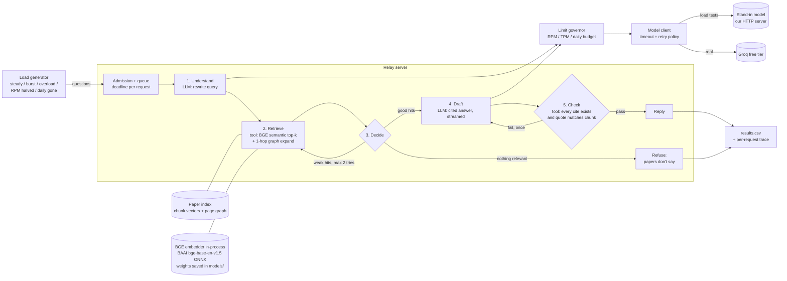

# The Relay: High-Level Design

**Language: Go.** Single module. Only stdlib + a PDF-to-text step at ingest time.

## What we are building

An assistant that answers questions **only** from 3 arXiv papers, cites where each claim came from, and says "the papers don't say" instead of guessing. It has to stay honest and usable when the model provider's rate limits bite.

## The picture



## Components

| Component | Job | Notes |
|---|---|---|
| **Ingest** (one-off) | 3 PDFs at exact versions (`data/papers/`, 120 pages), `pdftotext` per page, split into chunks tagged `paper / section / page`, embed each chunk with BGE | Chunk size is a knob, so we can compare 3 retrieval settings |
| **Embedder** | BAAI's official `bge-base-en-v1.5` ONNX weights from Hugging Face (110M params, 768-dim), saved once in `models/` and run inside the Go process with `hugot` + ONNX Runtime | Zero Groq budget, no extra server, no runtime download. [CLS] pooling as BGE was trained (hugot defaults to mean pooling, which would be wrong). Max 512 tokens: longer text is an error, never cut. Queries get BGE's "Represent this sentence for searching relevant passages: " prefix. Matches Ollama's independent conversion at cosine 0.99999 |
| **Paper index** | Chunk vectors in memory, brute-force cosine top-k | ~2K vectors: a vector DB would add a service for no speed gain |
| **Page graph** | Nodes = chunks. Edges: next/prev in the same section, section → parent section, and explicit refs ("Table 3", "Figure 2", "Section 4.1", "Eq. 5", "Appendix B") → the chunk that holds that caption or heading, same paper only | Built with regex at ingest, no LLM. Used to pull in a cited table or the rest of a split paragraph after top-k |
| **Admission + queue** | Bounded queue; each request has a give-up deadline; drop or shed when the queue is full | Goroutine worker pool sized from the measured "requests in flight" limit |
| **Pipeline** | The 5 steps above; one loop (re-retrieve) and one branch (refuse) | Step 5 is a plain code check, not an LLM call, so verifying costs no tokens |
| **Limit governor** | Token buckets for RPM and TPM, plus a daily counter; updated from Groq's `x-ratelimit-*` headers | Decides: wait, use a cheaper path (fewer chunks, skip step 1), or refuse |
| **Model client** | One interface, two backends (Groq / stand-in); streams tokens, records first-token time | Retries only on 429/5xx, honours `retry-after`, capped by the request's deadline |
| **Stand-in model** | `net/http` server speaking the OpenAI-style chat API with streaming (SSE) | Configurable: latency distribution, failure rate, 429 at RPM/TPM/daily limits, slows down as in-flight count rises. Calibrated from real Groq runs |
| **Load generator** | Fires questions in each load shape, writes one CSV row per request | Real Groq for small runs; stand-in for heavy ones |
| **Grader** | 15+ hand-written questions (some unanswerable) with expected answer + citation | Produces `answer_grade` column |

## The one decision that shapes everything

**The daily request budget is the scarcest thing, so every request spends at most 2 model calls** (understand + draft). Retrieval and citation checking are plain code. When the budget runs low we drop step 1 first, then shrink retrieved context, then refuse new requests with an honest "out of budget, try at X" reply, never a guessed answer.

## Retrieval settings to compare (Table 3), frozen 2026-11-11

| Setting | Chunk | Top-k | Search over | Purpose |
|---|---|---|---|---|
| A | ~300 tokens | 4 | chunks | Cheap baseline |
| B | ~480 tokens (bge-base max is 512) | 3 | chunks | More context per hit, more tokens |
| C | ~300 tokens | 4 | 2-sentence windows (1,929, stride 1), best window per parent chunk | Small-to-big: a one-line answer gets its own vector; the model still sees the whole 300-token chunk, so tokens match A |

Benchmark (22 PDF-verified questions, retrieval only; see `Docs/RETRIEVAL_EVAL.md`): **A 12/18 (66.7%)**, B 7/18 (38.9%), C 8/18 (44.4%) answerable questions fully retrieved. **A is the pipeline default.** Experimental: hybrid H10/H15 (BGE + BM25, RRF; `internal/retrieve/hybrid.go`) found 13/18 but gave no end-to-end gain, so it isn't adopted. The page graph and reranker are not built: no benchmark gap they would close. The A+meta variant (section prefix in embeddings) scored 13/18, which is within noise, so it isn't adopted.

**Not building an LLM-made knowledge graph (GraphRAG style).** Building it would send all 120 pages through Groq: roughly 120K+ tokens against a 200K daily budget, before answering a single question.

## Pipeline as built (2026-11-11, after the smoke-test fixes)

| Step | Kind | What it does | When it is skipped or changes |
|---|---|---|---|
| 2a. Retrieve | tool | Setting A top-4 on the raw question (~20 ms) | - |
| 3. Decide | branch | Best score < 0.50: refuse with no model call | - |
| 1. Understand | model call (max 150 tok) | JSON `{"query", "parts"}`: what the question asks for, ≤ 4 self-contained parts | Skipped below 100 daily requests left; on failure: one part = the question |
| 2b. Retrieve | tool | Search again with the rewrite, keep the best 4 | Only if the rewrite differs |
| 4. Draft | model call (max 350 tok), streamed | One `[P#] … [S#].` sentence per part, or `[P#] MISSING`, or `NOT IN PAPERS` | - |
| 5. Check | tool | Per sentence: `[S#]` names a real passage, every number appears in a cited passage. Only passing sentences are shown. Tracks which parts are covered | - |
| Loop | tool + model call | For missing parts: targeted retrieval per part (≤ 2 new chunks per part, ≤ 4 total), then a draft for those parts with only the new passages, checked the same way | Skipped with < 5 s left or < 100 daily requests left |
| End | - | Still-missing parts are said plainly. No part answered: "The papers do not say" + closest passages | - |

**At most 3 model calls per request** (up from 2): understand, draft, targeted draft. Offline, A averages 2.45. Every refusal now costs 3 calls, because the targeted round runs first.

**Reliability:** a 20 s give-up deadline per request. Each model call gets a 6 s first-token timeout and a 15 s attempt timeout. Up to 2 retries with jittered backoff, honouring `retry-after`. No retry on 400s or the daily-limit 429, and no retry that can't finish before the deadline. The governor waits for RPM/TPM room only if that wait fits the deadline. The daily budget is modelled as Groq runs it: it refills continuously, one request every 24 h / limit (measured 86.4 s), with full reset at `x-ratelimit-reset-requests`. When a model call can't be made, the person gets the passages most likely to answer, with labels, plus "next request in ~X, full quota back by HH:MM". Never a guessed answer.

**Offline result** (oracle model, `Docs/PIPELINE_OFFLINE_EVAL.md`): A 14/22 correct, 0 wrong, 4/4 refusals correct.

## How to run

One-time setup: `brew install onnxruntime`, then `go run -tags ORT ./cmd/getmodel` (saves the weights to `models/`, skips if already there).

Tests: `go test -tags ORT ./test -v`. Add `GROQ_LIVE=1` to also spend one real Groq request.

## Repo layout (planned)

```
cmd/relay/      pipeline server
cmd/standin/    fake model server
cmd/loadgen/    load shapes -> results.csv
cmd/ingest/     fetch + chunk papers
internal/       pipeline, retrieve, governor, llm client
data/           chunked papers, questions.json
results/        results.csv, raw traces
Docs/           brief, this file, 2-page write-up
```

## Open questions (decide after measuring Groq)

- Which Groq model: limits differ per model.
- Give-up deadline for a waiting person (start with 15 s).
- Queue size and worker count: set from measured in-flight limit.
