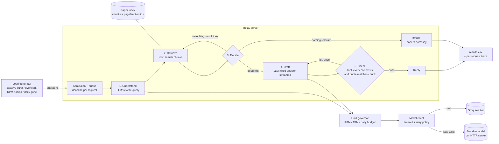

# The Relay: High-Level Design

**Language: Go.** Single module. Only stdlib + a PDF-to-text step at ingest time.

## What we are building

An assistant that answers questions **only** from 3 arXiv papers, cites where each claim came from, and says "the papers don't say" instead of guessing. It has to stay honest and usable when the model provider's rate limits bite.

## The picture



## Components

| Component | Job | Notes |
|---|---|---|
| **Ingest** (one-off) | Download the 3 PDFs at the exact versions, extract text, split into chunks tagged `paper / section / page` | Chunk size is a knob, so we can compare 3 retrieval settings |
| **Paper index** | In-memory BM25 search over chunks | No embeddings API, so retrieval spends zero model budget |
| **Admission + queue** | Bounded queue; each request has a give-up deadline; drop or shed when the queue is full | Goroutine worker pool sized from the measured "requests in flight" limit |
| **Pipeline** | The 5 steps above; one loop (re-retrieve) and one branch (refuse) | Step 5 is a plain code check, not an LLM call, so verifying costs no tokens |
| **Limit governor** | Token buckets for RPM and TPM, plus a daily counter; updated from Groq's `x-ratelimit-*` headers | Decides: wait, use a cheaper path (fewer chunks, skip step 1), or refuse |
| **Model client** | One interface, two backends (Groq / stand-in); streams tokens, records first-token time | Retries only on 429/5xx, honours `retry-after`, capped by the request's deadline |
| **Stand-in model** | `net/http` server speaking the OpenAI-style chat API with streaming (SSE) | Configurable: latency distribution, failure rate, 429 at RPM/TPM/daily limits, slows down as in-flight count rises. Calibrated from real Groq runs |
| **Load generator** | Fires questions in each load shape, writes one CSV row per request | Real Groq for small runs; stand-in for heavy ones |
| **Grader** | 15+ hand-written questions (some unanswerable) with expected answer + citation | Produces `answer_grade` column |

## The one decision that shapes everything

**The daily request budget is the scarcest thing, so every request spends at most 2 model calls** (understand + draft). Retrieval and citation checking are plain code. When the budget runs low we drop step 1 first, then shrink retrieved context, then refuse new requests with an honest "out of budget, try at X" reply, never a guessed answer.

## Repo layout (planned)

```
cmd/relay/      pipeline server
cmd/standin/    fake model server
cmd/loadgen/    load shapes -> results.csv
cmd/ingest/     fetch + chunk papers
internal/       pipeline, retrieve, governor, llm client
data/           chunked papers, questions.json
results/        results.csv, raw traces
Docs/           brief, this file, 2-page write-up
```

## Open questions (decide after measuring Groq)

- Which Groq model: limits differ per model.
- Give-up deadline for a waiting person (start with 15 s).
- Queue size and worker count: set from measured in-flight limit.
